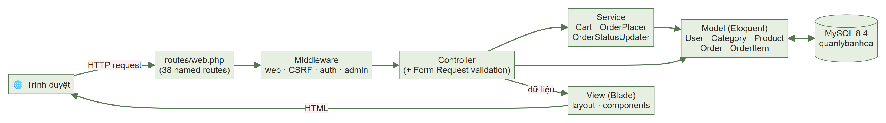
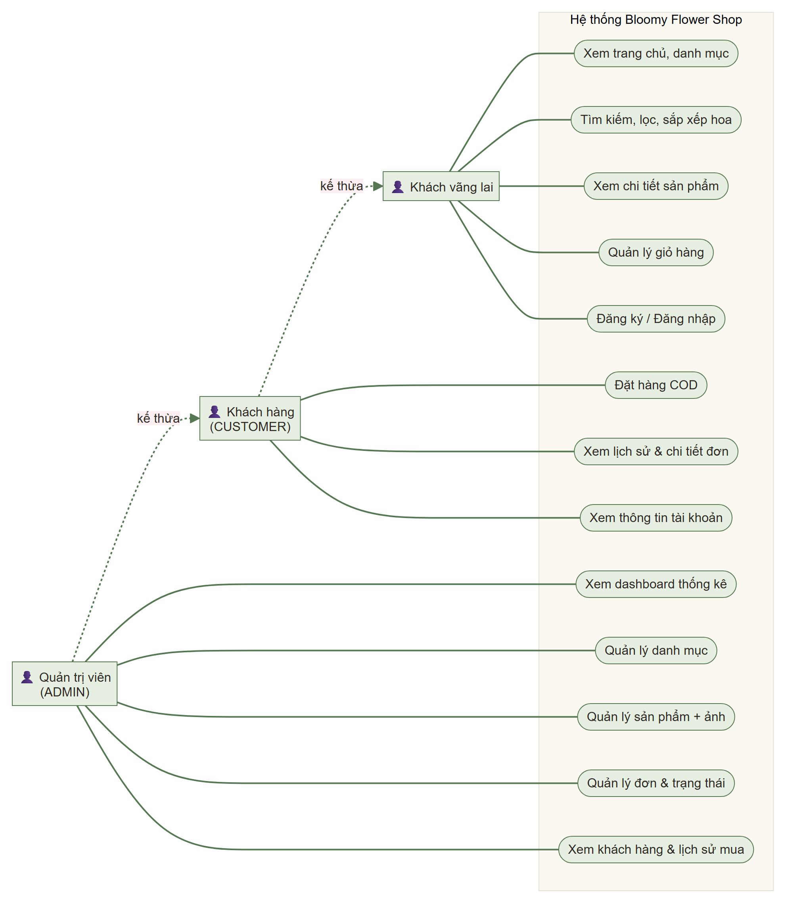
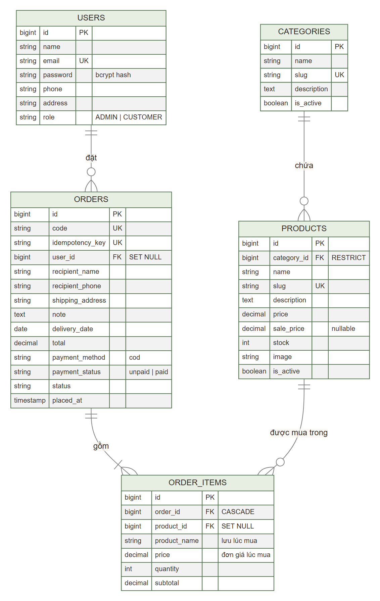
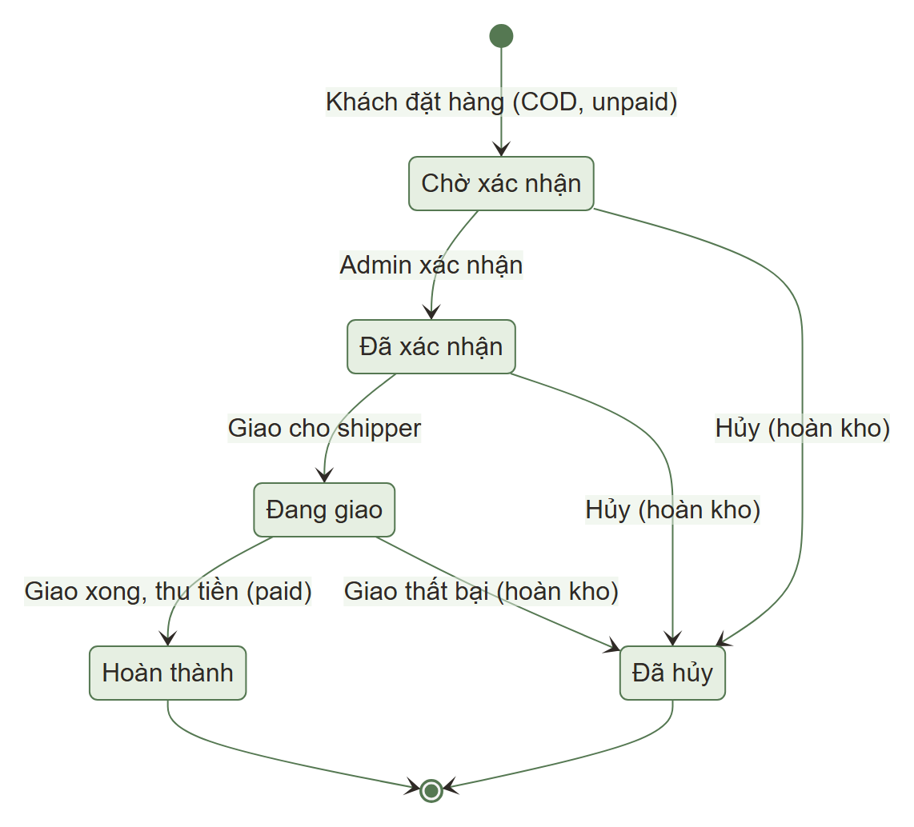
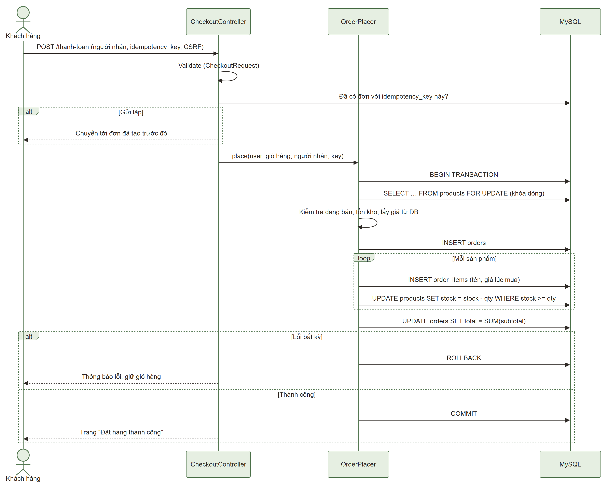

# BÁO CÁO ĐỒ ÁN MÔN LẬP TRÌNH MÃ NGUỒN MỞ

## Đề tài: Xây dựng website bán hoa tươi **Bloomy Flower Shop** bằng Laravel

> Ghi chú cho người làm báo cáo: các phần đánh dấu **[Điền]** là thông tin cá nhân/nhóm cần tự bổ sung.
> Các con số kỹ thuật trong báo cáo (số route, số test, kết quả kiểm thử…) đều lấy từ lần chạy thực tế trên máy phát triển.

| | |
|---|---|
| Sinh viên thực hiện | **[Điền họ tên – MSSV – Lớp]** |
| Giảng viên hướng dẫn | **[Điền]** |
| Trường | Trường Đại học Công Thương TP. Hồ Chí Minh |
| Thời gian | **[Điền]** |

---

## MỤC LỤC

1. Giới thiệu đề tài
2. Phân tích yêu cầu
3. Công nghệ sử dụng
4. Thiết kế hệ thống (kiến trúc, use case, ERD, nghiệp vụ)
5. Mô tả chức năng
6. Giải thích Laravel: MVC, Blade, Eloquent, Migration, Middleware
7. Bảo mật
8. Kiểm thử và kết quả
9. Hạn chế và hướng phát triển
10. Kết luận
- Phụ lục A – Kịch bản demo 7–10 phút
- Phụ lục B – Danh sách ảnh chụp màn hình cần chụp
- Phụ lục C – Hướng dẫn cài đặt
- Phụ lục D – Nguồn ảnh và tài liệu tham khảo

---

## CHƯƠNG 1. GIỚI THIỆU ĐỀ TÀI

### 1.1. Lý do chọn đề tài

- **Nhu cầu thực tế:** hoa tươi là mặt hàng gắn với nhiều dịp (sinh nhật, kỷ niệm, khai trương, chia buồn, cưới hỏi), khách thường cần đặt nhanh, xem trước mẫu và giá. Nhiều tiệm hoa nhỏ vẫn nhận đơn thủ công qua điện thoại/mạng xã hội, dễ sai sót về giá, số lượng và thông tin người nhận.
- **Đặc thù nghiệp vụ đáng học:** hoa là hàng tồn kho ít, dễ hết; một đơn hàng phải giữ đúng giá tại thời điểm mua; cùng lúc nhiều khách có thể đặt món cuối cùng. Đây là các bài toán điển hình về **transaction, kiểm soát tồn kho và toàn vẹn dữ liệu**.
- **Phù hợp môn Lập trình mã nguồn mở:** toàn bộ công nghệ (PHP, Laravel, MySQL, Bootstrap) là mã nguồn mở, có cộng đồng lớn, tài liệu đầy đủ và chạy được trên môi trường Laragon miễn phí.
- Website thương mại điện tử bao quát được hầu hết kiến thức của môn: mô hình MVC, ORM, xác thực – phân quyền, form & validation, upload file, bảo mật web.

### 1.2. Mục tiêu

1. Xây dựng website bán hoa có giao diện hiện đại, thân thiện, hiển thị tốt trên máy tính và điện thoại.
2. Khách hàng có thể xem, tìm kiếm, lọc hoa; quản lý giỏ hàng; đặt hàng thanh toán khi nhận (COD) hoặc chuyển khoản qua mã QR; theo dõi và tự hủy đơn.
3. Quản trị viên quản lý danh mục, sản phẩm (kèm ảnh), đơn hàng, khách hàng và xem thống kê doanh thu.
4. Đảm bảo tính đúng đắn của dữ liệu: giá tính ở server, không bán vượt tồn kho, giữ lịch sử giá, chống đặt trùng.
5. Áp dụng các biện pháp bảo mật cơ bản: hash mật khẩu, phân quyền phía server, CSRF, chống XSS/SQL injection, kiểm tra file upload.
6. Có bộ kiểm thử tự động để chứng minh các chức năng chính hoạt động.

### 1.3. Phạm vi

- **Trong phạm vi:** website một cửa hàng; thanh toán COD và chuyển khoản bằng mã QR (đối soát thủ công); 2 vai trò người dùng (CUSTOMER, ADMIN); chạy trên môi trường local (Laragon).
- **Ngoài phạm vi:** thanh toán online, tính phí vận chuyển, mã giảm giá, gửi email/SMS, triển khai lên hosting thật.

---

## CHƯƠNG 2. PHÂN TÍCH YÊU CẦU

### 2.1. Tác nhân (Actor)

| Tác nhân | Mô tả |
|---|---|
| Khách vãng lai | Người chưa đăng nhập: xem, tìm kiếm hoa, dùng giỏ hàng, đăng ký/đăng nhập |
| Khách hàng (CUSTOMER) | Đã đăng nhập: có mọi quyền của khách vãng lai + đặt hàng, xem đơn của mình |
| Quản trị viên (ADMIN) | Quản lý toàn bộ cửa hàng; không thể tự đăng ký, chỉ được tạo bởi seeder |

### 2.2. Yêu cầu chức năng

| Mã | Yêu cầu | Tác nhân |
|---|---|---|
| FR01 | Xem trang chủ: banner, danh mục, sản phẩm ưu đãi, sản phẩm mới | Tất cả |
| FR02 | Xem danh sách hoa: tìm theo tên, lọc theo danh mục, sắp xếp theo giá/tên/mới nhất, phân trang | Tất cả |
| FR03 | Xem chi tiết sản phẩm: ảnh, giá, giá khuyến mãi, mô tả, tồn kho, trạng thái còn/hết hàng | Tất cả |
| FR04 | Giỏ hàng: thêm, sửa số lượng, xóa, xem tổng số lượng và tổng tiền | Tất cả |
| FR05 | Đăng ký tài khoản khách hàng, đăng nhập, đăng xuất | Khách vãng lai |
| FR06 | Đặt hàng: nhập người nhận, SĐT, địa chỉ, ngày giao, ghi chú; chọn COD hoặc chuyển khoản (hiện mã QR, số tiền, nội dung = mã đơn) | CUSTOMER |
| FR06b | Tự hủy đơn khi đơn còn *Chờ xác nhận* và chưa thanh toán, có chọn lý do; tồn kho được hoàn ngay | CUSTOMER |
| FR06c | Trang Liên hệ có bản đồ vị trí cửa hàng và nút chỉ đường | Tất cả |
| FR07 | Trang xác nhận đặt hàng; lịch sử và chi tiết đơn của chính mình | CUSTOMER |
| FR08 | Xem thông tin tài khoản | CUSTOMER |
| FR09 | Dashboard: tổng sản phẩm, khách hàng, đơn hàng, doanh thu, đơn mới nhất | ADMIN |
| FR10 | Quản lý danh mục: thêm, sửa, ẩn/hiện, xóa (khi không còn sản phẩm), tìm kiếm, phân trang | ADMIN |
| FR11 | Quản lý sản phẩm: thêm, xem, sửa (giá, tồn kho, mô tả, ảnh), ngừng kinh doanh, tìm/lọc, phân trang | ADMIN |
| FR12 | Quản lý đơn: tìm theo mã, lọc trạng thái/khoảng ngày, xem chi tiết, cập nhật trạng thái theo quy tắc | ADMIN |
| FR13 | Quản lý khách hàng: xem thông tin cơ bản và lịch sử mua | ADMIN |

### 2.3. Yêu cầu phi chức năng

| Mã | Yêu cầu |
|---|---|
| NFR01 | Giao diện responsive (desktop, tablet, điện thoại), tiếng Việt, dễ sử dụng |
| NFR02 | Mật khẩu lưu dạng hash; phân quyền kiểm tra phía server; chống CSRF, XSS, SQL injection |
| NFR03 | Toàn vẹn dữ liệu: giá và tổng tiền tính ở server, không bán vượt tồn kho, giữ giá lịch sử của đơn |
| NFR04 | Thao tác đặt hàng nguyên tử (transaction): lỗi giữa chừng thì không để lại dữ liệu dở dang |
| NFR05 | Chạy được trên Laragon (Windows) với PHP 8.3, MySQL 8.4; không phụ thuộc framework frontend nặng |
| NFR06 | Có kiểm thử tự động cho các chức năng chính |

---

## CHƯƠNG 3. CÔNG NGHỆ SỬ DỤNG

| Thành phần | Phiên bản | Vai trò |
|---|---|---|
| PHP | 8.3.30 | Ngôn ngữ phía server |
| Laravel | 13.38.0 | Framework MVC |
| MySQL | 8.4.3 | Hệ quản trị CSDL (InnoDB, utf8mb4) |
| Composer | 2.8.12 | Quản lý thư viện PHP |
| Laragon | 2026 v8.6.1 | Môi trường phát triển (Apache, MySQL) trên Windows |
| Blade | (kèm Laravel) | Template engine |
| Bootstrap | 5.3.3 (CDN) | Giao diện responsive |
| Bootstrap Icons | 1.11.3 (CDN) | Biểu tượng |
| JavaScript thuần | — | Tương tác nhỏ: nút +/− số lượng, tự gửi form sắp xếp, khóa nút đặt hàng |
| PHPUnit | 12.5 | Kiểm thử tự động |

Dự án **không cài thêm package** ngoài bộ cài mặc định của Laravel; không dùng React/Vue.

---

## CHƯƠNG 4. THIẾT KẾ HỆ THỐNG

### 4.1. Kiến trúc tổng thể (MVC)



*Hình 4.1 – Luồng xử lý một request trong ứng dụng*

Một request đi qua: **Route** (xác định controller) → **Middleware** (phiên làm việc, CSRF, đăng nhập, quyền admin) → **Controller** (validate dữ liệu bằng Form Request) → **Service/Model** (nghiệp vụ, truy vấn MySQL qua Eloquent) → **View Blade** (sinh HTML trả về trình duyệt).

Tầng **Service** được tách riêng cho các nghiệp vụ phức tạp để controller gọn và dễ kiểm thử:

| Service | Nhiệm vụ |
|---|---|
| `Cart` | Giỏ hàng lưu trong session dạng `[product_id => số lượng]`; giá và tồn kho luôn đọc lại từ DB |
| `OrderPlacer` | Tạo đơn hàng trong một transaction, khóa dòng sản phẩm, trừ kho |
| `OrderStatusUpdater` | Chuyển trạng thái đơn theo quy tắc, hoàn kho khi hủy |

### 4.2. Sơ đồ use case



*Hình 4.2 – Sơ đồ use case tổng quát*

### 4.3. Thiết kế cơ sở dữ liệu (ERD)



*Hình 4.3 – Sơ đồ ERD của 5 bảng nghiệp vụ*

**Quan hệ:**

- `users` 1 – n `orders`: một khách có nhiều đơn. Khóa ngoại `SET NULL` khi xóa user để không mất đơn.
- `orders` 1 – n `order_items`: một đơn có nhiều dòng hàng. `CASCADE` khi xóa đơn.
- `products` 1 – n `order_items`: `SET NULL` khi xóa sản phẩm; dòng hàng vẫn giữ `product_name` và `price` lúc mua.
- `categories` 1 – n `products`: `RESTRICT` — không xóa được danh mục còn sản phẩm.

**Mô tả bảng:**

| Bảng | Mục đích | Ràng buộc đáng chú ý |
|---|---|---|
| `users` | Tài khoản, thông tin liên hệ, vai trò | `email` UNIQUE; `role` ∈ {ADMIN, CUSTOMER}, mặc định CUSTOMER |
| `categories` | Danh mục hoa | `slug` UNIQUE; `is_active` để ẩn danh mục |
| `products` | Sản phẩm hoa | `slug` UNIQUE; `price`, `sale_price` kiểu `DECIMAL(12,0)`; index `(category_id, is_active)` |
| `orders` | Đơn hàng | `code` UNIQUE (mã đơn dạng `BL261020XXXXX`); `idempotency_key` UNIQUE (chống đặt trùng); index `status`, `placed_at` |
| `order_items` | Dòng hàng của đơn | Lưu **bản sao tên và đơn giá lúc mua**; `subtotal` luôn tự tính = `price × quantity` |

Tiền dùng `DECIMAL(12,0)` vì đồng Việt Nam không có phần lẻ, tránh sai số của kiểu số thực.

Ngoài 5 bảng nghiệp vụ, Laravel tạo các bảng hệ thống: `sessions`, `cache`, `jobs`, `password_reset_tokens`, `migrations`.

### 4.4. Quy tắc trạng thái đơn hàng



*Hình 4.4 – Máy trạng thái của đơn hàng*

| Từ trạng thái | Được chuyển sang |
|---|---|
| Chờ xác nhận | Đã xác nhận, Đã hủy |
| Đã xác nhận | Đang giao, Đã hủy |
| Đang giao | Hoàn thành, Đã hủy |
| Hoàn thành / Đã hủy | — (trạng thái cuối) |

- **Hủy đơn** → hoàn lại tồn kho trong cùng transaction. Vì "Đã hủy" là trạng thái cuối nên không thể hủy hai lần để cộng kho hai lần.
- **Hoàn thành** → đơn COD chuyển `payment_status = paid` (tiền thu khi giao). Đơn **chuyển khoản** phải được admin bấm *Xác nhận đã nhận chuyển khoản* (đối soát số tiền và nội dung = mã đơn) trước, nếu chưa thì không được Hoàn thành.
- Khi đặt hàng, mọi đơn đều ở `payment_status = unpaid`.
- **Khách tự hủy**: chỉ khi đơn còn *Chờ xác nhận* và chưa thanh toán; lưu lý do, người hủy (`cancelled_by`) và thời điểm (`cancelled_at`), hoàn kho trong cùng transaction.
- Nếu hai quản trị viên cùng sửa một đơn, form gửi kèm trạng thái mà admin đang thấy; nếu khác trạng thái thực tế thì yêu cầu bị từ chối.

**Quy tắc doanh thu:** doanh thu = tổng `total` của các đơn **Hoàn thành**. Đơn **Đã hủy** không bao giờ được tính; giá trị các đơn đang xử lý được hiển thị riêng.

### 4.5. Luồng đặt hàng (checkout)



*Hình 4.5 – Sơ đồ tuần tự quá trình đặt hàng*

Các điểm thiết kế chính:

1. **Giá tính ở server:** session chỉ lưu ID sản phẩm và số lượng; giá, tổng tiền được đọc lại từ DB ngay trong transaction. Dữ liệu `total`, `price`, `status`, `payment_status` gửi từ trình duyệt đều bị bỏ qua.
2. **Khóa dòng (`SELECT … FOR UPDATE`)** các sản phẩm theo thứ tự id. Hai khách cùng mua món cuối cùng thì khách sau phải chờ khách trước xong, rồi đọc lại tồn kho mới nhất.
3. **Trừ kho có điều kiện** `WHERE stock >= qty` — lớp bảo vệ thứ hai, không bao giờ để tồn kho âm.
4. **Transaction:** tạo `orders`, `order_items` và trừ kho cùng thành công hoặc cùng bị hủy (rollback).
5. **Chống gửi trùng:** mỗi lần mở trang thanh toán có một `idempotency_key` (UUID); khóa này UNIQUE trong DB, gửi lại form thì được chuyển tới đơn đã tạo. Nút "Đặt hàng" cũng tự khóa sau lần bấm đầu.

---

## CHƯƠNG 5. MÔ TẢ CHỨC NĂNG

### 5.1. Phía khách hàng

| Chức năng | Mô tả | Đường dẫn |
|---|---|---|
| Trang chủ | Banner ảnh, dải cam kết, 6 danh mục kèm ảnh và số mẫu, 4 sản phẩm ưu đãi, 8 mẫu hoa mới | `/` |
| Danh sách hoa | Thẻ sản phẩm có ảnh, giá, % giảm giá, nhãn "Hết hàng"; tìm kiếm, lọc danh mục, sắp xếp (mới nhất / giá tăng / giá giảm / tên), 9 sản phẩm mỗi trang, giữ bộ lọc khi chuyển trang | `/san-pham` |
| Chi tiết sản phẩm | Ảnh lớn, giá, giá gốc gạch ngang, tồn kho, mô tả, chọn số lượng, thêm giỏ; gợi ý sản phẩm cùng danh mục | `/san-pham/{slug}` |
| Giỏ hàng | Sửa số lượng, xóa, tổng tiền; cảnh báo nếu sản phẩm hết hàng/ngừng bán/không đủ hàng | `/gio-hang` |
| Đăng ký / đăng nhập | Validation tiếng Việt; khóa tạm sau 5 lần đăng nhập sai | `/dang-ky`, `/dang-nhap` |
| Thanh toán | Điền sẵn từ hồ sơ; người nhận, SĐT, địa chỉ, ngày giao (trong 60 ngày), ghi chú; chọn COD hoặc chuyển khoản | `/thanh-toan` |
| Thanh toán chuyển khoản | Hiện mã QR của cửa hàng, số tiền và nội dung cần ghi (mã đơn) ở trang xác nhận và trang chi tiết đơn | `/don-hang/{mã}` |
| Hủy đơn | Nút *Hủy đơn hàng* + chọn lý do, chỉ hiện khi đơn còn chờ xác nhận và chưa thanh toán | `/don-hang/{mã}` |
| Liên hệ & bản đồ | Bản đồ Leaflet + OpenStreetMap ghim vị trí Trường ĐH Công Thương TP.HCM, nút chỉ đường Google Maps | `/lien-he` |
| Xác nhận đơn | Mã đơn, người nhận, tổng tiền, "Chưa thanh toán" | `/dat-hang-thanh-cong/{mã}` |
| Đơn hàng của tôi | Danh sách và chi tiết đơn (giá lúc mua, trạng thái) | `/don-hang` |
| Tài khoản | Thông tin cá nhân, lối tắt | `/tai-khoan` |

Dữ liệu mẫu: **6 danh mục, 55 sản phẩm** có ảnh, 1 sản phẩm cố ý hết hàng để minh họa.

### 5.2. Phía quản trị (`/admin`)

| Chức năng | Mô tả |
|---|---|
| Tổng quan | Doanh thu (đơn hoàn thành), số đơn và giá trị đang xử lý, số khách hàng, số sản phẩm; 8 đơn mới nhất; số đơn và giá trị theo từng trạng thái (thanh tỉ lệ bằng CSS); sản phẩm hết hàng |
| Đơn hàng | Tìm theo mã, lọc trạng thái và khoảng ngày, 15 đơn/trang; chi tiết đơn (người nhận, sản phẩm với giá lúc mua, tổng tiền); cập nhật trạng thái — chỉ hiện các trạng thái được phép chuyển |
| Khách hàng | Tìm theo tên/email/SĐT; số đơn, tổng đã mua; trang chi tiết với lịch sử đơn |
| Sản phẩm | Thêm/xem/sửa; giá, giá khuyến mãi (phải nhỏ hơn giá bán), tồn kho, mô tả, ảnh (JPG/PNG/WEBP ≤ 2 MB); ngừng kinh doanh/mở bán lại; xóa chỉ khi chưa có trong đơn nào; lọc theo danh mục và trạng thái |
| Danh mục | Thêm, sửa, ẩn/hiện, xóa khi không còn sản phẩm; slug tự sinh |

Giao diện quản trị dùng sidebar và bảng dữ liệu, tách riêng với giao diện cửa hàng.

---

## CHƯƠNG 6. GIẢI THÍCH CÁC THÀNH PHẦN LARAVEL ĐÃ SỬ DỤNG

### 6.1. Mô hình MVC trong Laravel

- **Model** (`app/Models`): lớp Eloquent đại diện cho bảng — `User`, `Category`, `Product`, `Order`, `OrderItem`. Chứa quan hệ, ép kiểu, phạm vi truy vấn (scope) và quy tắc nhỏ (ví dụ `Product::finalPrice()`, `Order::canTransitionTo()`).
- **View** (`resources/views`): file Blade sinh HTML.
- **Controller** (`app/Http/Controllers`): nhận request, gọi model/service, trả view hoặc chuyển hướng. Khu quản trị đặt trong thư mục `Admin/`.

Ví dụ khai báo route có tên (named route) và nhóm phân quyền trong `routes/web.php`:

```php
Route::get('/san-pham/{product:slug}', [ProductController::class, 'show'])->name('products.show');

Route::middleware(['auth', 'admin'])->prefix('admin')->name('admin.')->group(function () {
    Route::get('/', [DashboardController::class, 'index'])->name('dashboard');
    Route::resource('products', AdminProductController::class);
    // ...
});
```

View luôn tạo link bằng tên route, ví dụ `route('products.show', $product)`, nên đổi URL không làm hỏng liên kết.

### 6.2. Blade

- **Layout bằng component:** `x-layout` (cửa hàng) và `x-admin-layout` (quản trị) dùng chung header/footer cho mọi trang.
- **Component tái sử dụng:** `x-product-card`, `x-product-image` (ảnh thật hoặc minh họa SVG nếu thiếu ảnh), `x-price`, `x-admin-order-status`.
- **Tự động escape:** `{{ $product->name }}` chuyển `<script>` thành văn bản, chống XSS. Chỗ cần xuống dòng dùng `{!! nl2br(e($text)) !!}` — vẫn escape trước.
- **Directive:** `@csrf`, `@method('PATCH')`, `@auth`, `@error`, `@foreach`, `@class`.

```blade
<x-layout title="Giỏ hàng">
    @foreach ($lines as $line)
        <x-product-image :product="$line->product" />
        {{ $line->product->name }}
    @endforeach
</x-layout>
```

### 6.3. Eloquent ORM

- **Quan hệ:** `Category hasMany Product`, `Product belongsTo Category`, `User hasMany Order`, `Order hasMany OrderItem`, `OrderItem belongsTo Product`.
- **Eager loading** tránh truy vấn N+1: `Product::with('category')->paginate(9)`.
- **Scope:** `Product::visible()` = đang bán và thuộc danh mục đang hiển thị.
- **Bảo vệ gán hàng loạt:** thuộc tính `#[Fillable]` liệt kê các cột được phép gán; `role`, `total`, `status` không nằm trong đó.
- **Cast:** `'password' => 'hashed'` tự hash mật khẩu; tiền ép kiểu `integer`; ngày ép kiểu `date`.
- **Model event:** `OrderItem` tự tính `subtotal` khi lưu; `Order` tự sinh mã đơn khi tạo.

```php
// Lấy sản phẩm đang bán, tìm theo tên, sắp xếp theo giá sau khuyến mãi
Product::visible()->with('category')
    ->where('name', 'like', '%'.$keyword.'%')        // tham số ràng buộc, không nối chuỗi SQL
    ->orderByRaw('COALESCE(sale_price, price) asc')
    ->paginate(9);
```

### 6.4. Migration và Seeder

- 12 migration tạo và thay đổi cấu trúc bảng theo từng bước; có `down()` để hoàn tác.
- Khi cần đổi cấu trúc ở giai đoạn sau (thêm `is_active`, mã đơn, `payment_status`…), dự án **thêm migration mới** thay vì sửa migration cũ → không phải xóa dữ liệu.
- Seeder tạo dữ liệu mẫu: `UserSeeder` (tài khoản demo, mật khẩu lấy từ `.env` hoặc sinh ngẫu nhiên — không viết cứng), `CategorySeeder`, `ProductSeeder` (55 mẫu hoa), `ProductImageSeeder` (gán ảnh). Dùng `updateOrCreate` nên chạy lại không tạo trùng.

```php
Schema::create('order_items', function (Blueprint $table) {
    $table->id();
    $table->foreignId('order_id')->constrained()->cascadeOnDelete();
    $table->foreignId('product_id')->nullable()->constrained()->nullOnDelete();
    $table->string('product_name');      // tên lúc mua
    $table->decimal('price', 12, 0);     // đơn giá lúc mua
    $table->unsignedInteger('quantity');
    $table->decimal('subtotal', 12, 0);
    $table->timestamps();
});
```

### 6.5. Middleware, Policy và Form Request

- **Middleware** chạy trước controller:
  - `auth`: chưa đăng nhập → chuyển về trang đăng nhập.
  - `guest`: đã đăng nhập thì không vào trang đăng nhập/đăng ký.
  - `admin` (tự viết – `EnsureUserIsAdmin`): không phải ADMIN → 403.
  - `throttle`: giới hạn số lần gửi form đăng ký/đặt hàng.
  - `RejectInvalidUtf8` (tự viết): từ chối dữ liệu sai mã hóa ký tự (400).
  - Middleware CSRF có sẵn của Laravel: thiếu token → 419.

```php
class EnsureUserIsAdmin
{
    public function handle(Request $request, Closure $next): Response
    {
        abort_unless($request->user()?->isAdmin(), 403, 'Bạn không có quyền truy cập khu vực quản trị.');
        return $next($request);
    }
}
```

- **Policy** `OrderPolicy::view`: chỉ chủ đơn hoặc ADMIN được xem chi tiết đơn.
- **Form Request** (`CheckoutRequest`, `ProductRequest`, `CategoryRequest`): gom quy tắc validation, tên trường và thông báo tiếng Việt.

---

## CHƯƠNG 7. BẢO MẬT

| Nguy cơ | Biện pháp trong dự án |
|---|---|
| Lộ mật khẩu | Hash bcrypt (cast `hashed`); không có mật khẩu viết cứng trong code; `.env` nằm trong `.gitignore` |
| Leo thang quyền | Middleware `admin` bọc toàn bộ `/admin/*`; `role` không gán hàng loạt được → không thể tự đăng ký ADMIN |
| Xem đơn của người khác | `OrderPolicy` → 403 |
| CSRF | `@csrf` trên mọi form ghi dữ liệu; đăng xuất bắt buộc POST |
| Chiếm phiên (session fixation) | `session()->regenerate()` khi đăng nhập; `invalidate()` + `regenerateToken()` khi đăng xuất |
| Dò mật khẩu | Khóa tạm sau 5 lần đăng nhập sai (RateLimiter) |
| XSS | Blade `{{ }}` tự escape; nội dung nhiều dòng dùng `nl2br(e())` |
| SQL injection | Chỉ dùng Eloquent/Query Builder (tham số ràng buộc); ký tự `%`, `_` trong ô tìm kiếm được escape |
| Upload file độc hại | Chỉ nhận ảnh JPG/PNG/WEBP thật (kiểm tra nội dung và MIME), ≤ 2 MB, 200–5000 px; chặn SVG, PHP, EXE; tên file do Laravel sinh ngẫu nhiên |
| Sửa giá từ trình duyệt | Giá, tổng tiền, trạng thái luôn tính/gán ở server |
| Bán vượt tồn kho, đặt trùng | Khóa dòng + transaction + trừ kho có điều kiện; `idempotency_key` UNIQUE |

---

## CHƯƠNG 8. KIỂM THỬ VÀ KẾT QUẢ

### 8.1. Phương pháp kiểm thử

1. **Kiểm thử tự động (PHPUnit Feature test):** 81 test, 534 phép kiểm tra. Chạy trên SQLite trong bộ nhớ nên không ảnh hưởng database thật. Lệnh: `php artisan test`.
2. **Kiểm thử tích hợp trên MySQL thật:** gửi request HTTP (công cụ `curl`, có cookie phiên và CSRF token) vào website đang chạy để kiểm tra toàn luồng; dữ liệu thử được dọn sau khi kiểm tra.
3. **Kiểm thử tranh chấp:** chạy 2 tiến trình PHP song song cùng mua sản phẩm còn 1 món trên MySQL.
4. **Kiểm thử dò lỗi (fuzz):** gửi tham số bất thường (dạng mảng `?q[]=x`, chuỗi sai mã UTF-8, chuỗi chứa `<script>`) vào mọi trang.
5. **Kiểm tra giao diện:** chụp màn hình bằng trình duyệt Edge chế độ không giao diện ở độ rộng 1366px (desktop), 820px (tablet), 390px (điện thoại).

### 8.2. Kết quả kiểm thử tự động

| Nhóm test | Số test | Kết quả |
|---|---|---|
| Xác thực & phân quyền (`AuthTest`) | 18 | PASS 18/18 |
| Quản lý danh mục, sản phẩm, upload ảnh (`AdminCatalogTest`) | 15 | PASS 15/15 |
| Giỏ hàng & đặt hàng (`CheckoutTest`) | 15 | PASS 15/15 |
| Quản lý đơn, dashboard, khách hàng (`AdminOrderTest`) | 11 | PASS 11/11 |
| Cửa hàng: tìm kiếm, lọc, sắp xếp, phân trang (`StorefrontTest`) | 6 | PASS 6/6 |
| Bảo mật: XSS, tham số bất thường, UTF-8 (`SecurityTest`) | 3 | PASS 3/3 |
| Test mẫu của Laravel | 2 | PASS 2/2 |
| Thanh toán chuyển khoản, khách tự hủy đơn, trang bản đồ (`PaymentAndCancelTest`) | 11 | PASS 11/11 |
| **Tổng** | **81** | **PASS 81/81 (534 assertions)** |

### 8.3. Các ca kiểm thử chính

| # | Ca kiểm thử | Cách kiểm tra | Kết quả |
|---|---|---|---|
| 1 | Kết nối MySQL, 12 migration đã chạy, 38 route | `db:show`, `migrate:status`, `route:list` | PASS |
| 2 | Đăng ký hợp lệ → tài khoản CUSTOMER, mật khẩu hash bcrypt | Test + HTTP/MySQL | PASS |
| 3 | Gửi kèm `role=ADMIN` khi đăng ký → vẫn là CUSTOMER | Test + HTTP/MySQL | PASS |
| 4 | Email trùng, mật khẩu nhập lại sai, mật khẩu quá ngắn | Test + HTTP | PASS |
| 5 | Đăng nhập sai mật khẩu; khóa tạm sau 5 lần | Test + HTTP | PASS |
| 6 | Đăng xuất hủy phiên; gửi lại token cũ → 419 | Test + HTTP | PASS |
| 7 | Khách chưa đăng nhập vào trang cần đăng nhập → trang đăng nhập | Test + HTTP | PASS |
| 8 | CUSTOMER vào mọi route `/admin` → 403, dữ liệu không đổi | Test + HTTP | PASS |
| 9 | ADMIN vào dashboard và các trang quản trị | Test + HTTP | PASS |
| 10 | CRUD danh mục; không xóa được danh mục còn sản phẩm | Test + HTTP/MySQL | PASS |
| 11 | CRUD sản phẩm; validation (giá âm, khuyến mãi ≥ giá bán, danh mục không tồn tại…) | Test + HTTP | PASS |
| 12 | Upload ảnh JPG thật → lưu với tên ngẫu nhiên, hiển thị ở cửa hàng | Test + HTTP | PASS |
| 13 | Upload file PHP đội lốt `.jpg`, file `.php`, `.svg` chứa script, `.exe`, `.pdf`, ảnh > 2 MB → bị chặn, không ghi file | Test + HTTP | PASS |
| 14 | Ngừng kinh doanh → ẩn khỏi cửa hàng (404); không xóa cứng sản phẩm đã có trong đơn | Test + HTTP | PASS |
| 15 | Tìm kiếm, lọc, sắp xếp theo giá sau khuyến mãi, phân trang giữ bộ lọc | Test + HTTP | PASS |
| 16 | Thêm giỏ: số lượng 0/âm/chữ, vượt tồn kho, sản phẩm hết hàng → bị từ chối | Test + HTTP | PASS |
| 17 | Đặt hàng thành công: tổng tiền tính ở server (bỏ qua `total=1000` gửi giả mạo), đơn `pending`/`unpaid`, trừ kho, xóa giỏ | Test + HTTP/MySQL | PASS |
| 18 | Giỏ hàng trống → không đặt được | Test + HTTP | PASS |
| 19 | Gửi lặp cùng form đặt hàng → chỉ 1 đơn | Test + HTTP/MySQL | PASS |
| 20 | Lỗi giữa transaction (giả lập lỗi ở dòng hàng thứ 2) → rollback: 0 đơn mới, tồn kho không đổi, giỏ hàng còn nguyên | Test + **MySQL thật** | PASS |
| 21 | Hai tiến trình cùng mua món cuối cùng → 1 thành công, 1 báo hết hàng, tồn kho = 0 | **MySQL thật, chạy song song** | PASS |
| 22 | Người khác xem đơn → 403; ADMIN xem được | Test + HTTP | PASS |
| 23 | Đổi giá sản phẩm sau khi mua → đơn cũ giữ giá lúc mua | Test | PASS |
| 24 | Chuyển trạng thái hợp lệ đến Hoàn thành → `paid` | Test + HTTP/MySQL | PASS |
| 25 | Chuyển trạng thái sai quy tắc (Chờ xác nhận → Hoàn thành; Đã hủy → Chờ xác nhận) → bị từ chối | Test + HTTP | PASS |
| 26 | Hai admin cập nhật chồng nhau → yêu cầu sau bị từ chối | Test + HTTP | PASS |
| 27 | Hủy đơn → hoàn kho (15 → 18) | Test + HTTP/MySQL | PASS |
| 28 | Doanh thu dashboard = tổng đơn Hoàn thành tính bằng SQL; đơn hủy không tính | Test + so sánh với SQL | PASS |
| 29 | CSRF: 15/15 route ghi dữ liệu trả 419 khi thiếu token | HTTP | PASS |
| 30 | XSS lưu trữ: chèn `<script>` vào tên SP, mô tả, ghi chú, tên khách → escape trên 17 trang | Test | PASS |
| 31 | XSS phản xạ qua ô tìm kiếm (6 trang) | HTTP | PASS |
| 32 | Tham số dạng mảng `?q[]=x` trên 21 trang → không còn lỗi 500 | Test + HTTP | PASS (sau khi sửa) |
| 33 | Dữ liệu sai mã UTF-8 → 400, không tạo bản ghi | Test + HTTP | PASS (sau khi sửa) |
| 34 | Giao diện responsive ở 390px, 820px, 1366px: không tràn ngang, menu thu gọn | Ảnh chụp Edge | PASS |
| 35 | Giờ đặt hàng hiển thị đúng giờ Việt Nam | Quan sát | **FAIL** – đang hiển thị giờ UTC (lệch 7 tiếng), xem mục 9.1 |
| 36 | Thao tác chuột thật: hộp xác nhận JavaScript, double-click nút đặt hàng, chọn file qua hộp thoại | — | **BLOCKED** – chưa có người thao tác thật trên trình duyệt; cần tự kiểm tra khi demo |
| 37 | Hai request đặt hàng **cùng `idempotency_key`** gửi đúng cùng lúc | — | **BLOCKED** – mới kiểm tra gửi tuần tự; trường hợp đồng thời được chặn bởi ràng buộc UNIQUE theo thiết kế nhưng chưa chạy song song thật |
| 38 | Trình duyệt khác (Chrome, Firefox, Safari) và điện thoại thật | — | **BLOCKED** – chỉ kiểm tra bằng Edge |

**Tổng hợp:** 34 PASS · 1 FAIL (hiển thị múi giờ) · 3 BLOCKED (cần kiểm thử thủ công).

### 8.4. Lỗi phát hiện trong quá trình kiểm thử và cách khắc phục

| # | Lỗi | Nguyên nhân | Khắc phục |
|---|---|---|---|
| 1 | `?sort[]=x` gây lỗi 500 trên trang danh sách | Hàm xử lý nhận mảng thay vì chuỗi | Kiểm tra kiểu dữ liệu, giá trị sai thì dùng mặc định |
| 2 | `?q[]=x` gây lỗi 500 trên mọi trang có header và 3 trang quản trị | In/ép kiểu mảng thành chuỗi | Chỉ nhận `q` khi là chuỗi (`searchTerm()` dùng chung) |
| 3 | Gửi dữ liệu sai mã UTF-8 gây lỗi 500 | MySQL từ chối chuỗi byte không hợp lệ | Middleware `RejectInvalidUtf8` trả 400 |
| 4 | Thông báo validation còn tiếng Anh | Thiếu bản dịch cho một số quy tắc | Bổ sung `lang/vi/validation.php` |
| 5 | Nhập số lượng âm trong giỏ không thấy thông báo | Trang giỏ hàng chưa hiển thị lỗi validate | Thêm khối hiển thị lỗi |
| 6 | URL ảnh sai host khi chạy qua `quanlybanhoa.test` | URL dựng từ `APP_URL` | Dùng `asset()` theo host hiện tại |
| 7 | Báo lỗi thừa "slug bắt buộc" khi bỏ trống tên | Quy tắc `required` cho slug tự sinh | Đổi thành `required_with:name` |

---

## CHƯƠNG 9. HẠN CHẾ VÀ HƯỚNG PHÁT TRIỂN

### 9.1. Hạn chế

- Ứng dụng đang dùng múi giờ **UTC**: giờ đặt hàng hiển thị lệch 7 tiếng và bộ lọc ngày trong quản trị tính theo ngày UTC. Cách sửa: `APP_TIMEZONE=Asia/Ho_Chi_Minh` (chưa áp dụng).
- Thanh toán chuyển khoản dùng **mã QR tĩnh** nên khách phải tự nhập số tiền và nội dung; cửa hàng đối soát và xác nhận thủ công. Chưa tích hợp cổng thanh toán tự động (VNPay/MoMo API cần đăng ký mã merchant).
- Chưa có phí vận chuyển, mã giảm giá.
- Chưa có: quên mật khẩu, xác minh email, sửa hồ sơ, gửi email xác nhận đơn, nhật ký thay đổi trạng thái đơn.
- Ảnh sản phẩm mẫu lấy từ Wikimedia Commons, chỉ mang tính minh họa — một số ảnh là tranh vẽ hoặc không khớp hoàn toàn với tên sản phẩm.
- Giao diện tải Bootstrap và font qua CDN nên cần Internet.
- Trang lỗi 403/404/419 dùng giao diện mặc định của Laravel.
- Chỉ chạy trên môi trường local; chưa cấu hình triển khai (APP_DEBUG=false, HTTPS, hàng đợi…).

### 9.2. Hướng phát triển

1. Thanh toán online (VNPay, MoMo) và tính phí giao hàng theo khu vực.
2. Mã giảm giá, chương trình khuyến mãi theo dịp (Valentine, 8/3, 20/10).
3. Gửi email/SMS xác nhận đơn và thông báo đổi trạng thái (Laravel Mail + Queue).
4. Quên mật khẩu, xác minh email, sửa hồ sơ, sổ địa chỉ.
5. Đánh giá sản phẩm, danh sách yêu thích, gợi ý hoa theo dịp.
6. Nhật ký trạng thái đơn, báo cáo doanh thu theo ngày/tháng, xuất Excel.
7. Tùy chọn ngày giờ giao và lời nhắn in trên thiệp.
8. Triển khai lên hosting/VPS, thiết lập HTTPS, sao lưu database.

---

## CHƯƠNG 10. KẾT LUẬN

Đồ án đã xây dựng hoàn chỉnh website bán hoa **Bloomy Flower Shop** trên nền Laravel 13 và MySQL, đáp ứng các yêu cầu đề ra: khách hàng xem – tìm – lọc hoa, quản lý giỏ hàng, đặt hàng COD và theo dõi đơn; quản trị viên quản lý danh mục, sản phẩm, đơn hàng, khách hàng và xem thống kê.

Qua đồ án, nhóm vận dụng được mô hình MVC, Blade component, Eloquent ORM, migration – seeder, middleware – policy – form request của Laravel; đồng thời xử lý các bài toán nghiệp vụ quan trọng như transaction, khóa dòng chống bán vượt tồn kho, giữ giá lịch sử, chống đặt trùng, quy tắc chuyển trạng thái đơn và các biện pháp bảo mật web cơ bản. Bộ 70 test tự động và các lần kiểm thử trên MySQL thật cho thấy các chức năng chính hoạt động đúng.

---

## PHỤ LỤC A – KỊCH BẢN DEMO 7–10 PHÚT

**Chuẩn bị trước buổi demo:**
- Laragon đã bật, website mở sẵn.
- Hai cửa sổ trình duyệt: cửa sổ thường đăng nhập ADMIN, cửa sổ ẩn danh cho khách.
- Một cửa sổ Terminal của Laragon ở thư mục dự án.
- Giỏ hàng trống.

| Thời gian | Nội dung | Thao tác | Điểm cần nói |
|---|---|---|---|
| 0:00 – 0:45 | Giới thiệu | Mở trang chủ | Đề tài, công nghệ (Laravel 13, MySQL, Blade, Bootstrap), 2 vai trò |
| 0:45 – 2:00 | Duyệt hoa | Bấm một danh mục → tìm "hồng" → sắp xếp "Giá tăng dần" → sang trang 2 → mở chi tiết | Dữ liệu lấy từ MySQL qua Eloquent; giá sau khuyến mãi; phân trang giữ bộ lọc |
| 2:00 – 2:30 | Hết hàng | Mở "Kệ lan hồ điệp Thịnh Vượng" | Nút mua bị khóa; tồn kho kiểm tra ở server |
| 2:30 – 3:30 | Giỏ hàng | Thêm 2 sản phẩm → sửa số lượng → thử nhập số lượng lớn hơn tồn kho | Session chỉ lưu ID + số lượng, giá đọc lại từ DB; thông báo "Chỉ còn … sản phẩm" |
| 3:30 – 5:00 | Đặt hàng | Bấm Tiến hành đặt hàng → bị yêu cầu đăng nhập → đăng nhập khách → thử để trống tên (lỗi validation) → điền đúng → Đặt hàng | Transaction, khóa dòng, giá tính ở server, đơn COD = "Chưa thanh toán" |
| 5:00 – 5:30 | Đơn của tôi | Xem lịch sử và chi tiết đơn | Giá lưu tại thời điểm mua |
| 5:30 – 6:00 | Phân quyền | Ở tài khoản khách, gõ `/admin` | Lỗi 403 do middleware `admin` chặn ở server, không chỉ ẩn nút |
| 6:00 – 7:30 | Quản trị đơn | Cửa sổ admin: Dashboard → Đơn hàng → tìm mã đơn vừa đặt → chuyển Đã xác nhận → Đang giao → Hoàn thành → quay lại Dashboard | Quy tắc trạng thái; doanh thu chỉ tính đơn Hoàn thành |
| 7:30 – 8:30 | Quản trị sản phẩm | Sửa giá một sản phẩm → mở lại đơn cũ (giá không đổi) → thêm sản phẩm mới có ảnh → ngừng kinh doanh một sản phẩm | Giữ giá lịch sử; kiểm tra file upload; không xóa cứng |
| 8:30 – 9:30 | Kiểm thử | Terminal: `php vendor/bin/phpunit --testdox` | 81/81 test PASS, gồm test rollback, XSS, hủy đơn |
| 9:30 – 10:00 | Kết luận | — | Hạn chế và hướng phát triển |

**Câu hỏi có thể gặp và gợi ý trả lời:**

- *Tại sao không tin tổng tiền từ form?* → Người dùng có thể sửa HTML/request; server tự tính từ DB.
- *Hai người cùng mua món cuối thì sao?* → `SELECT … FOR UPDATE` trong transaction; đã kiểm thử bằng 2 tiến trình song song trên MySQL.
- *Xóa sản phẩm thì đơn cũ bị mất thông tin?* → Không: không cho xóa sản phẩm đã bán; `order_items` lưu tên và giá lúc mua.
- *Phân quyền làm ở đâu?* → Middleware `EnsureUserIsAdmin` và `OrderPolicy` phía server.

---

## PHỤ LỤC B – DANH SÁCH ẢNH CHỤP MÀN HÌNH CẦN CHỤP

Chụp ở cửa sổ trình duyệt toàn màn hình (khuyến nghị 1366×768 hoặc 1920×1080), dữ liệu thật trên máy.

| Hình | Màn hình | Ghi chú khi chụp |
|---|---|---|
| 5.1 | Trang chủ (banner + danh mục) | Cuộn lên đầu trang |
| 5.2 | Trang chủ (ưu đãi + hoa mới) | Cuộn xuống |
| 5.3 | Danh sách sản phẩm có bộ lọc | Chọn một danh mục + sắp xếp giá tăng |
| 5.4 | Kết quả tìm kiếm "hồng" | |
| 5.5 | Chi tiết sản phẩm còn hàng | |
| 5.6 | Chi tiết sản phẩm hết hàng | "Kệ lan hồ điệp Thịnh Vượng" |
| 5.7 | Giỏ hàng có 2–3 sản phẩm | |
| 5.8 | Thông báo vượt tồn kho | |
| 5.9 | Trang đăng ký có lỗi validation | Để trống / email trùng |
| 5.10 | Trang thanh toán | |
| 5.11 | Trang đặt hàng thành công | Có mã đơn |
| 5.12 | Đơn hàng của tôi + chi tiết đơn | |
| 5.13 | Lỗi 403 khi khách vào `/admin` | Thấy rõ thanh địa chỉ |
| 5.14 | Dashboard quản trị | Sau khi có ít nhất 1 đơn Hoàn thành |
| 5.15 | Danh sách đơn có bộ lọc | |
| 5.16 | Chi tiết đơn + ô cập nhật trạng thái | |
| 5.17 | Danh sách / chi tiết khách hàng | |
| 5.18 | Danh sách sản phẩm quản trị | |
| 5.19 | Form thêm/sửa sản phẩm có ảnh | |
| 5.20 | Lỗi upload file không hợp lệ | Thử file PDF |
| 5.21 | Danh sách danh mục | |
| 5.22 | Giao diện điện thoại | F12 → Ctrl+Shift+M → iPhone |
| 8.1 | Kết quả `php vendor/bin/phpunit --testdox` | Cửa sổ Terminal của Laragon |
| 8.2 | Bảng dữ liệu trong HeidiSQL | Bảng `orders`, `order_items` |

---

## PHỤ LỤC C – HƯỚNG DẪN CÀI ĐẶT (TÓM TẮT)

Chi tiết đầy đủ trong file `README.md` của dự án.

```bash
cd C:\laragon\www\QuanLyBanHoa
composer install
copy .env.example .env          # sửa DB_DATABASE=quanlybanhoa
php artisan key:generate
php artisan storage:link
php artisan migrate --seed      # tạo bảng + dữ liệu mẫu (in mật khẩu demo ra màn hình)
php artisan serve --port=8090   # hoặc mở http://quanlybanhoa.test:8000 qua Apache
php artisan test                # chạy 81 test tự động
```

---

## PHỤ LỤC D – NGUỒN ẢNH VÀ TÀI LIỆU THAM KHẢO

**Nguồn ảnh:** ảnh sản phẩm và banner lấy từ Wikimedia Commons theo giấy phép tự do (CC0, Public domain, CC BY, CC BY-SA). Tên tác giả, giấy phép và liên kết gốc của từng ảnh được ghi trong `database/seeders/images/CREDITS.md`.

**Tài liệu tham khảo:**

1. Laravel Documentation (13.x) — https://laravel.com/docs
2. PHP Manual — https://www.php.net/manual
3. MySQL 8.4 Reference Manual — https://dev.mysql.com/doc/refman/8.4/en/
4. Bootstrap 5.3 Documentation — https://getbootstrap.com/docs/5.3/
5. OWASP Top 10 — https://owasp.org/www-project-top-ten/
6. Laragon Documentation — https://laragon.org/docs
